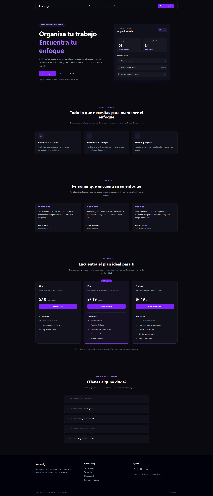

# Focusly — Landing Page

## 📷 Vista previa



Landing page de una plataforma ficticia de productividad diseñada para ayudar a las personas a organizar sus tareas, administrar su tiempo y mejorar su enfoque.

El proyecto fue desarrollado como parte de mi proceso de aprendizaje de React, TypeScript y Tailwind CSS, con especial atención a la reutilización de componentes, el tipado de propiedades y la organización del código.

## ✨ Características

- **Navbar responsive:** navegación entre secciones y menú adaptable a dispositivos móviles.
- **Efecto glassmorphism:** barra de navegación con fondo translúcido y desenfoque.
- **Sección Hero:** presentación de la plataforma con botones de acción.
- **Características:** tarjetas reutilizables generadas a partir de datos.
- **Testimonios:** presentación de opiniones mediante componentes reutilizables.
- **Planes y precios:** tarjetas dinámicas con beneficios y un plan destacado.
- **Preguntas frecuentes:** acordeón interactivo para mostrar y ocultar respuestas.
- **Footer:** enlaces de navegación y accesos a redes sociales.
- **Diseño responsive:** adaptación a diferentes tamaños de pantalla.
- **Tema oscuro:** interfaz con detalles violetas y estética tecnológica.

## 🛠️ Tecnologías utilizadas

- **React:** construcción de interfaces mediante componentes.
- **TypeScript:** tipado de propiedades y estructuras de datos.
- **Vite:** entorno de desarrollo y herramienta de compilación.
- **Tailwind CSS:** estilos mediante clases utilitarias.
- **Lucide React:** iconos de interfaz.
- **React Icons:** iconos de marcas y redes sociales.

## 📚 Conceptos practicados

- Creación y reutilización de componentes.
- Comunicación de datos mediante props.
- Definición de tipos e interfaces con TypeScript.
- Renderizado dinámico de elementos con `.map()`.
- Uso de `key` para identificar elementos de listas.
- Organización de componentes y datos en carpetas.
- Renderizado condicional.
- Manejo básico del estado con `useState`.
- Creación de un acordeón interactivo.
- Diseño responsive con Tailwind CSS.
- Navegación entre secciones mediante anclas HTML.

## 📁 Estructura del proyecto

```text
src/
├── components/
│   ├── Button.tsx
│   ├── Navbar.tsx
│   ├── Hero.tsx
│   ├── Features.tsx
│   ├── FeatureCard.tsx
│   ├── Testimonials.tsx
│   ├── TestimonialCard.tsx
│   ├── Pricing.tsx
│   ├── PricingCard.tsx
│   ├── FAQ.tsx
│   ├── FAQItem.tsx
│   └── Footer.tsx
├── data/
│   ├── features.ts
│   ├── testimonials.ts
│   ├── plans.ts
│   └── faqs.ts
├── App.tsx
└── main.tsx
```

## 🚀 Instalación y ejecución

### Requisitos

- Node.js en una versión compatible con las dependencias del proyecto.
- npm.

### Pasos

1. Clona el repositorio:

   ```bash
   git clone URL_DE_TU_REPOSITORIO
   ```

2. Entra en la carpeta del proyecto:

   ```bash
   cd nombre-del-proyecto
   ```

3. Instala las dependencias:

   ```bash
   npm install
   ```

4. Inicia el servidor de desarrollo:

   ```bash
   npm run dev
   ```

5. Abre en el navegador la URL local que muestre la terminal.

### Compilación para producción

```bash
npm run build
```

Para comprobar la compilación localmente:

```bash
npm run preview
```

## 🎯 Objetivo del proyecto

Este proyecto tiene como objetivo reforzar los fundamentos de React mediante la construcción progresiva de una interfaz realista, priorizando la comprensión del código, la reutilización de componentes y la separación entre presentación y datos.

## 🔮 Mejoras futuras

- Crear una versión administrable con un panel de control.
- Conectar los planes y testimonios a una base de datos.
- Permitir la edición de preguntas frecuentes.
- Añadir autenticación para administradores.
- Mejorar la accesibilidad y las animaciones.
- Implementar pruebas para los componentes.

## 📌 Estado del proyecto

Proyecto de práctica en desarrollo.

Los precios, testimonios y contenidos de Focusly son ilustrativos y no representan necesariamente una plataforma comercial real.